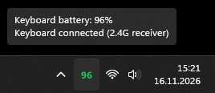
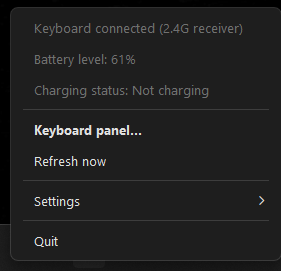

# OnionTray

A system tray battery monitor for the **Dark Project ALU104A Onionite V2 Wireless** keyboard, written in Python with PyQt6. A companion to [HyperTray](https://github.com/rafal-p4wlowski/HyperTray) (HyperX headset).

[](https://github.com/rafal-p4wlowski/OnionTray/releases/latest)

## Features

- **Battery in the tray:** a ring around a keyboard glyph fills clockwise with the battery level. It follows the taskbar colour (white on dark, black on light) and turns amber 10 points above the low-battery threshold and red at it. The exact level is in the tooltip. Refreshed every 10 s to 10 min (default 1 min).
- **2.4G receiver and USB cable:** read directly over HID from the receiver's vendor interface.
- **Bluetooth:** when the receiver does not answer, the battery level Windows reports for the paired `ALU104 ...` Bluetooth device is used (can be turned off in Settings).
- **Sleep aware:** while the keyboard sleeps the icon is dimmed, and the tooltip keeps the last reading with the time it was taken.
- **Charging:** the ring turns green while the keyboard charges over the USB cable.
- **Low battery warning:** a Windows notification at 10 / 15 / 20 / 30% (configurable or off).
- **Left click** refreshes immediately. **Start with Windows** from the Settings submenu. Only one instance runs at a time.

## Screenshots

| Tray Hover (Battery Level) | Context Menu |
| :---: | :---: |
|  |  |

## Usage

```bash
python -m venv .venv
.venv\Scripts\pip install -r requirements.txt
.venv\Scripts\python main.py
```

A log is written to `%APPDATA%\OnionTray\oniontray.log`. Set `ONIONTRAY_DEBUG=1` to also log every HID report.

## Protocol

The receiver (VID `0C45`, PID `FEFE`) exposes a vendor HID interface on usage page `FF60`. After two init packets (`AA 00 ...`, `AA 01 ...`), the status packet `AA 10 18 00 00 00 01` is answered with `55 10 ...`, where byte 24 is the connection mode (0/1 USB cable, 2 receiver, 3 Bluetooth) and byte 25 the battery level. A level of 0 means the keyboard is asleep. The device is opened only for each poll, so the vendor software can still use it.

## Executable

```bash
.venv\Scripts\pip install pyinstaller
.venv\Scripts\pyinstaller --noconfirm OnionTray.spec
```
The result is `dist/OnionTray.exe`. The icon (`assets/icon.ico`) is generated by `python tools/make_icon.py`.

## Development

Tests run against a simulated receiver (`tests/fake_hid.py`), no keyboard needed:
```bash
.venv\Scripts\pip install -r requirements-dev.txt
.venv\Scripts\python -m pytest
```

## Releasing

Update `__version__` in `version.py`, then `git tag v1.0.0 && git push origin main --tags`. GitHub Actions builds `OnionTray.exe` and publishes a release.

## Credits

- Tray icon presentation (battery ring around a device glyph) after [HaloBattery](https://github.com/HeyOkay/HaloBattery) by HeyOkay (MIT).
- Keyboard glyph from [Lucide](https://lucide.dev/) 1.17.0 (ISC, includes Feather's MIT notice), redrawn as Qt paths. License text: [licenses/lucide-1.17.0-LICENSE.txt](licenses/lucide-1.17.0-LICENSE.txt).

## License

MIT
